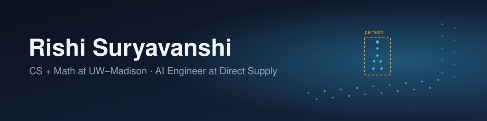

  

<h1 align="center">Hi, I'm Rishi 👋</h1>

I'm a CS and Math student at UW–Madison and an AI Engineer at Direct Supply. I like building machine-learning systems that work on messy real-world data, then measuring honestly how well they work.

  
  
  

## 🔭 Right now

Building **[lidar-mapping-detection](https://github.com/Rishi-S20/lidar-mapping-detection)**: an iPhone LiDAR mapper that finds people in the dark. The phone streams depth and motion-sensor data to a Mac, which builds a live 3D map with no camera image, and a classifier looks for people in that map. It began as a team hackathon project (MadHacks, Nov 2026). The first detector baseline finds 4 of 11 real people in held-out scans, so there's plenty left to improve.

## 🛠 Projects

| Project | What it is |
|---|---|
| [**lidar-mapping-detection**](https://github.com/Rishi-S20/lidar-mapping-detection) | Dark-room 3D mapping and person detection from iPhone LiDAR and IMU data (Swift, Python, Databricks). |
| [**TennisPredictionModel**](https://github.com/Rishi-S20/TennisPredictionModel) | Predicts ATP match winners from 2006–2024 data. 63% accuracy against a 50% coin-flip baseline. |
| [**NewBotanical**](https://github.com/Rishi-S20/NewBotanical) | SwiftUI iOS plant-identification app with a custom Python/TensorFlow classifier and watering reminders. |

## 🧰 Stack

  
  
  

